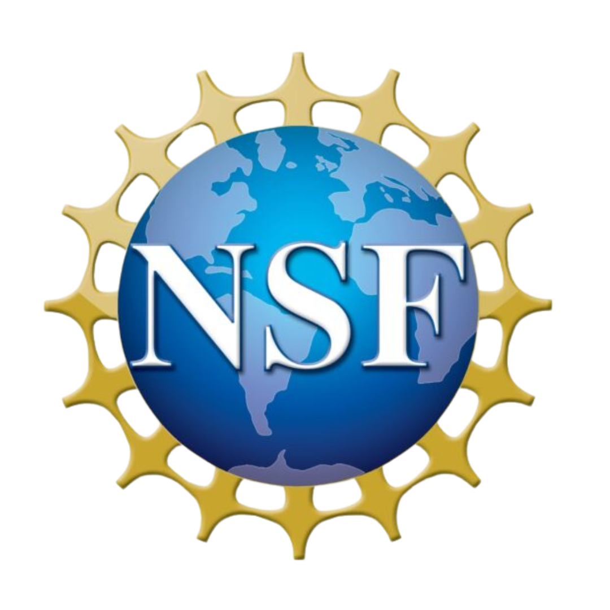
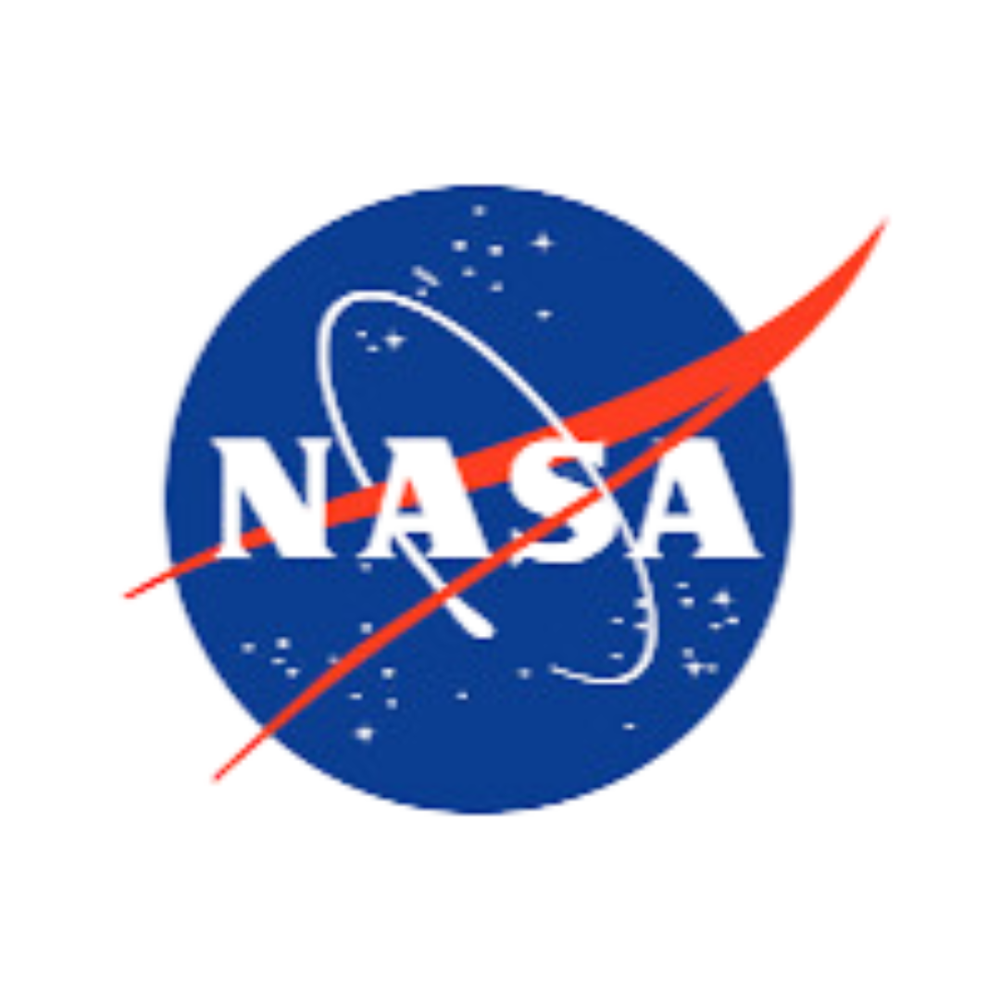
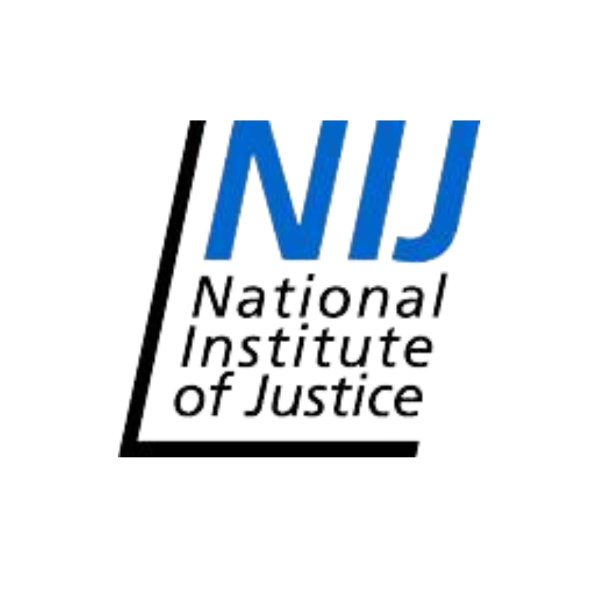

## Acknowledgments of Support

The Proto-OKN initiative is supported by the following agencies:

{ width="100" }

* National Science Foundation
    * [Directorate for Technology, Innovation and Partnerships (TIP) / Innovation and Technology Ecosystems (ITE)](https://new.nsf.gov/tip/latest)

{ width="100" }

* National Aeronautics and Space Administration
    * [Biological and Physical Sciences Division (BPS)](https://science.nasa.gov/biological-physical/)

{ width="100" }

* National Institutes of Health (NIH)
    * [Office of Data Science Strategy (ODSS)](https://datascience.nih.gov/about/odss)

{ width="100" }

* [National Institute of Justice](https://nij.ojp.gov/funding/funding-build-open-knowledge-networks-address-societal-challenges-nij-partners-national-science)

{ width="100" }

* National Oceanic and Atmospheric Administration
    * [National Centers for Environmental Information (NCEI)](https://www.ncei.noaa.gov/)

{ width="100" }

* U.S. Geological Survey
    * [National Geospatial Technical Operations Center (NGTOC)](https://www.usgs.gov/national-geospatial-technical-operations-center)
