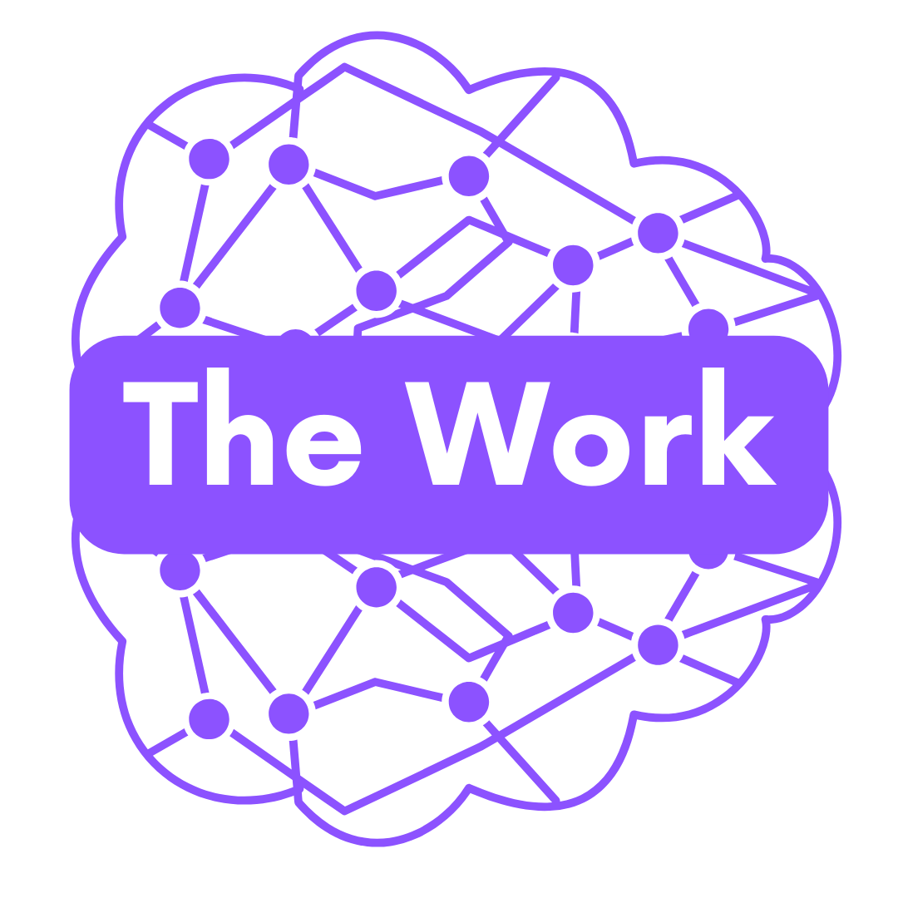
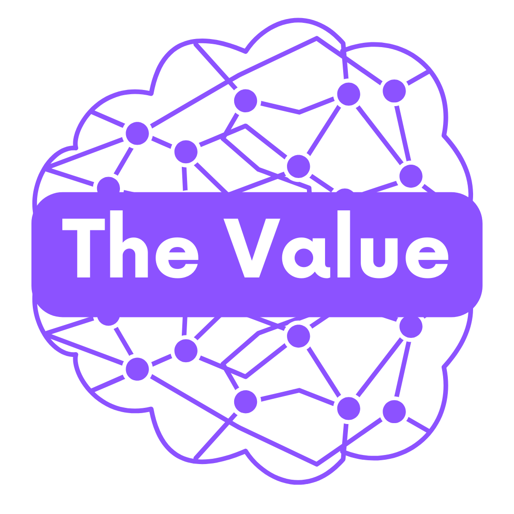
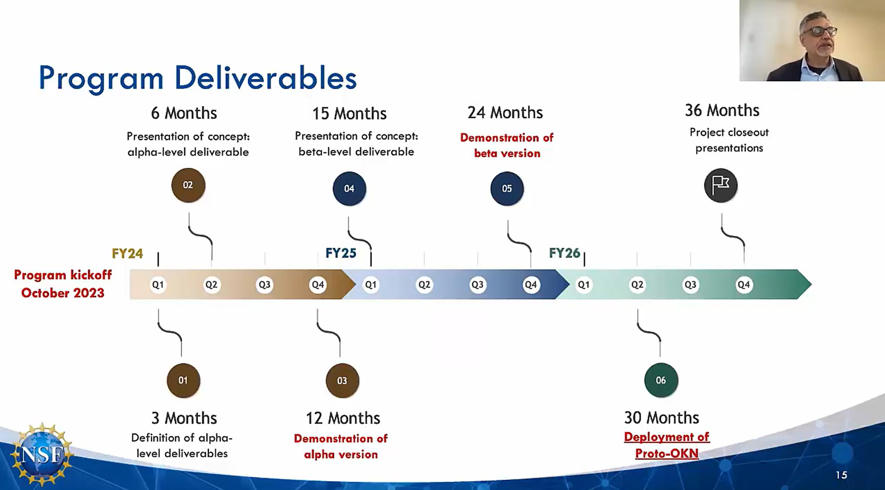
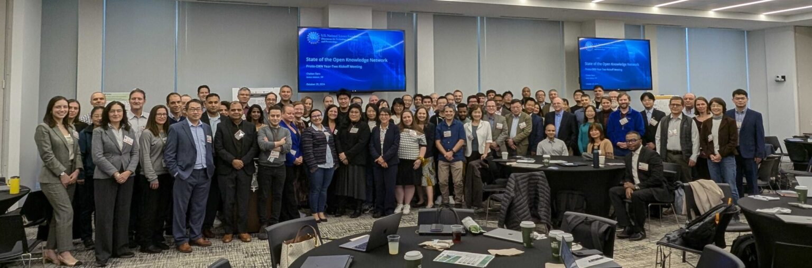
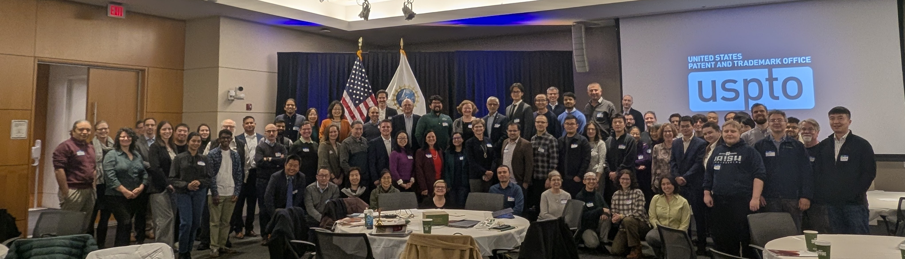

# About the Prototype Open Knowledge Network (Proto-OKN)

!!! info Historical note

    This page reproduces the text of [https://www.proto-okn.net/about/](https://www.proto-okn.net/about/)
    and is kept here only as a historical reference.

## The Goal

{ width="600" }

In collaboration with five other U.S. government agencies, [the U.S. National Science Foundation has invested $26.7 million in 18 projects through its Building the Prototype Open Knowledge Network (Proto-OKN) program](https://new.nsf.gov/tip/updates/nsf-invests-first-ever-prototype-open-knowledge-network).

An open knowledge network is a publicly accessible, interconnected set of data repositories and associated knowledge graphs that will enable data-driven, artificial intelligence-based solutions and actionable insights that will drive U.S. competitiveness.

NASA, NIH, the National Institute of Justice, NOAA and the U.S. Geological Survey are partnering with NSF on this effort and will work closely with the awardees to ensure that Proto-OKN supports each agency’s data strategy while addressing use cases associated with agency data. An additional 15 U.S. federal and state agencies have shown interest in collaborating with the 18 awardees.

## The Work

{ width="600" }

The NSF-funded Proto-OKN projects will pursue data validation procedures, processes and metrics to ensure that underlying data are accurate, complete and meet specified criteria. 

They will also prototype scalable, cloud-based technical infrastructure to address challenges across health care, space, criminal justice, the environment and many other fields. 

## The Value

{ width="600" }

The Proto-OKN will benefit a broad range of people and organizations — including government agencies, businesses, nonprofits, researchers and others — by providing access to integrated information for a variety of uses, such as pursuing societal and economic opportunities, driving evidence-based policies and developing novel AI capabilities. 

Proto-OKN will provide an essential public data infrastructure to power the next information revolution, transforming the nation’s ability to unlock actionable insights from data by linking information about related entities.

## Timeline

[Watch ‘Intro to Building the Proto-OKN’ on YouTube](https://youtu.be/3GfsPYnIB4c)

{ width="768" }

OKN Vision: From NSF’s Harnessing the Data Revolution (HDR) Big Idea, an interconnected network of public data that can help power the next wave of artificial intelligence exploration, while addressing various societal challenges.

FIRST STEP: NSF Convergence Accelerator Track A
* 21 Phase 1 Projects (2019-2020)
* 5 Phase 2 Projects (2020-2022)

SECOND STEP: Innovation Sprint (February – June 2022)
* Developed the [“Open Knowledge Network Roadmap: Powering the Next Data Revolution, September 2022”](https://nsf-gov-resources.nsf.gov/2022-09/OKN%20Roadmap%20-%20Report_v03.pdf) for a Prototype OKN, driven by Use Cases to help understand the scope of opportunities and challenges.

THIRD STEP: Building the Prototype Open Knowledge Network
* Solicitation to help build the Proto-OKN

{ width="1536" }

Year 2 Kickoff Event, PIs, Co-PIs, Agency Collaborators, and Team Members 

{ width="1536" }

Year 3 Kickoff Event, PIs, Co-PIs, Agency Collaborators, and Team Members
