# Knowledge Graph Use Cases

!!! info Historical note

    This page reproduces the text of [https://www.proto-okn.net/theme-1-projects/](https://www.proto-okn.net/theme-1-projects/)
    and is kept here only as a historical reference.

Projects in this category develop knowledge graphs or “nodes” of the Proto-OKN that address specific use-case challenges using well-identified data sets and a user-centric design process to help ensure usability and sustainability of the effort. Knowledge Graph Use Case projects work in close collaboration with OKN Fabric projects to deploy their use cases on a common implementation fabric.

## Biology & Health

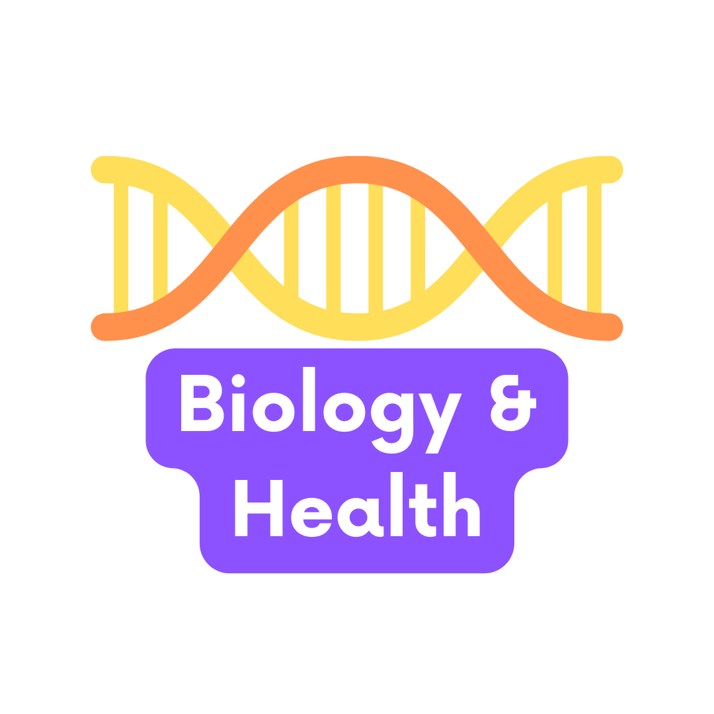{ width="300" }

These projects are part of the Biology & Health Group.

### BioBricks-OKG: BioBricks Open Knowledge Graph

{ width="300" }

* [NSF Award #2333728](https://www.nsf.gov/awardsearch/show-award?AWD_ID=2333728)
* PI: Thomas Leuchtefeld, Insilica
* [Website](https://github.com/biobricks-ai)
* [Datasheet](../assets/datasheets/BioBricks-Datasheet.pdf)
* [Project Overview Video](https://youtu.be/tEB63U7V5yU)

### SPOKE: Scalable Precision Medicine Open Knowledge Engine

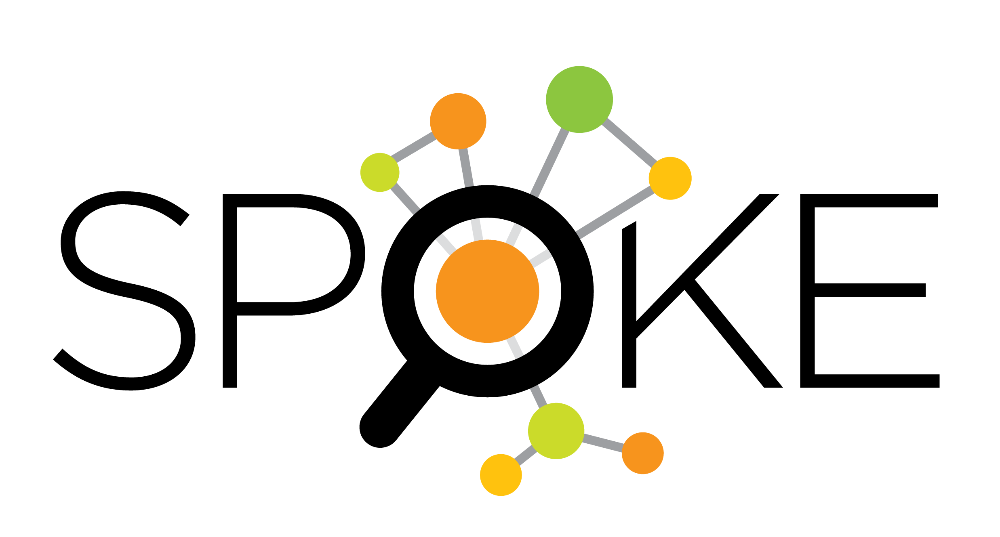{ width="300" }

* [NSF Award #2333819](https://www.nsf.gov/awardsearch/show-award?AWD_ID=2333819)
* PI: Sergio Baranzini, University of California, San Francisco
* [Website](https://spoke.ucsf.edu/prototype-open-knowledge-network-proto-okn-spoke-space-health)
* [Datasheet](../assets/datasheets/SPOKE-Datasheet.pdf)
* [Project Overview Video](https://youtu.be/vlWXvxyxQog)
* [Technical Video (Part 1)](https://youtu.be/bCgffFYEE3M)
* [Technical Video (Part 2)](https://youtu.be/50L-tKCoXJE)

### Bio-Health OKN: Bio-Health Open Knowledge Network

!!! info

    This was one of the original use cases before its 2025 administrative termination.

* [NSF Award #2333740](https://www.nsf.gov/awardsearch/showAward?AWD_ID=2333740&HistoricalAwards=false)
* PI: Aidong Zhang, University of Virginia
* Co-PIs: Rahmatollah Beheshti, Stefan Bekiranov, Kishlay Jha, Cathy Wu
* [Website](https://www.bio-healthokn.com/)
* [Datasheet](../assets/datasheets/Bio-Health%20Datasheet.pdf)

## Environment

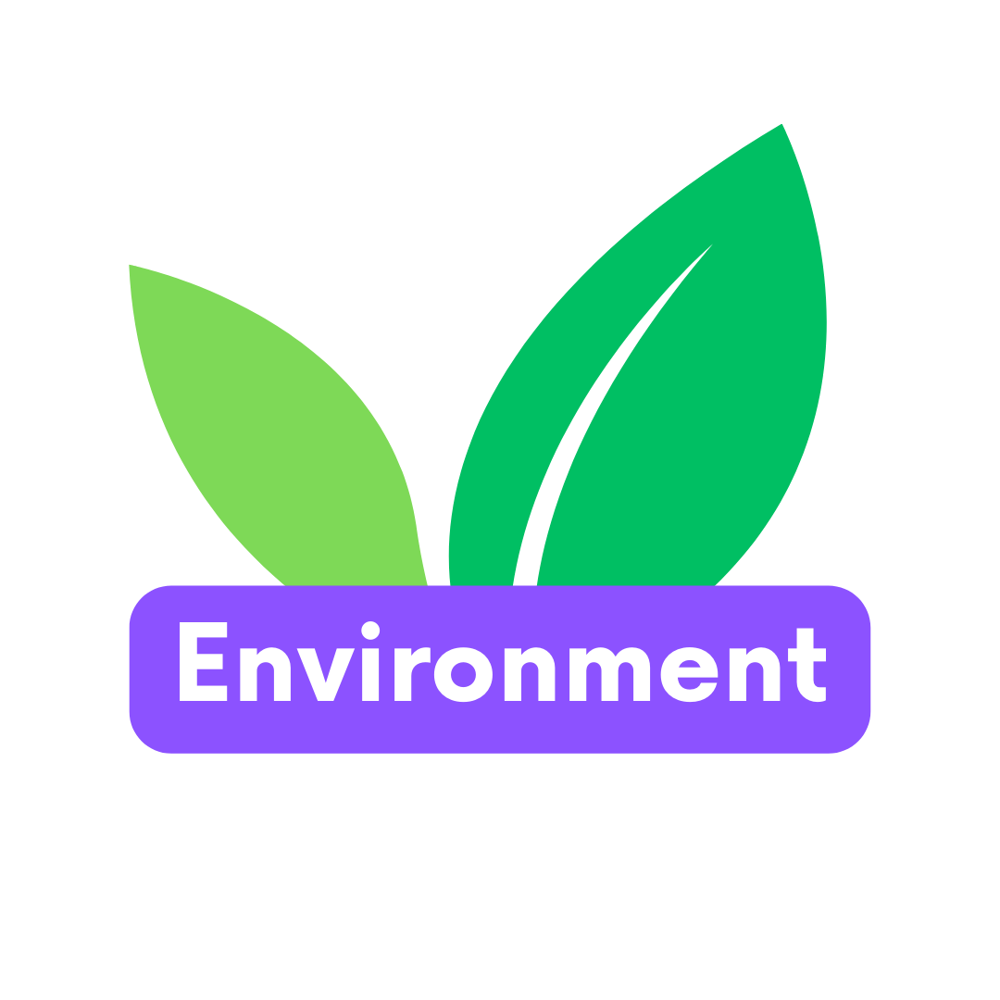{ width="300" }

These projects are part of the Environment Group.

### SAWGraph: Safe Agricultural Products and Water Graph

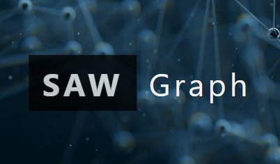{ width="300" }

* [NSF Award #2333782](https://www.nsf.gov/awardsearch/show-award?AWD_ID=2333782)
* PI: Torsten Hahmann, University of Maine
* Co-PIs: Onur Apul, Ganga Hettiarachchi, Pascal Hitzler, Hari Prasath Palani
* [Website](https://sawgraph.github.io/)
* [Datasheet](../assets/datasheets/SAW-Graph-Datasheet.pdf)
* [Project Overview Video](https://youtu.be/vS82LsLjZ5U)
* [Technical Video (Part 1)](https://youtu.be/0Tx27vZMWpE)
* [Technical Video (Part 2)](https://youtu.be/hysIlKUwhR4)

### WEN-OKN: The Water-Energy Nexus Open Knowledge Network

* [NSF Award #2333726](https://www.nsf.gov/awardsearch/show-award?AWD_ID=2333726)
* PI: Lilit Yeghiazarian, University of Cincinnati
* Co-PIs: Siddharth Saksena, Eric Welch, Ilya Zaslavsky, Justin Zhan
* [Website](https://data2action.tech/)
* [Datasheet](../assets/datasheets/WEN-OKN-Datasheet.pdf)
* [Project Overview Video](https://youtu.be/3w5Je4DO99I)
* [WEN-OKN Demo](https://www.youtube.com/watch?v=Kxp1LTV0LoU)

### KN-Wildlife: A Multi-modal Knowledge Network for Comprehensive Wildlife Management

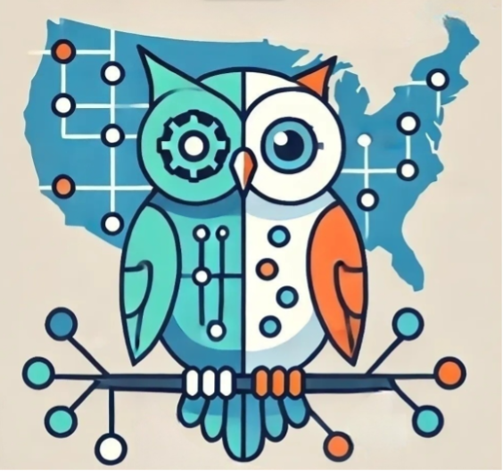{ width="300" }

* [NSF Award #2333795](https://www.nsf.gov/awardsearch/show-award?AWD_ID=2333795)
* PI: Xiangliang Zhang, University of Notre Dame
* Co-PIs: Nitesh Chawla, Jason Rohr, Brett Scheffers
* [Website](https://sites.nd.edu/kn-wildlife/)
* [Datasheet](../assets/datasheets/KN-Wildlife-Datasheet.pdf)
* [Project Overview Video](https://youtu.be/mz6If0FlJy8)
* [Technical Video](https://youtu.be/tqoCe2Avdqc)

### ClimatePub4KG: Knowledge Graph to Support Evaluation and Development of Climate Models

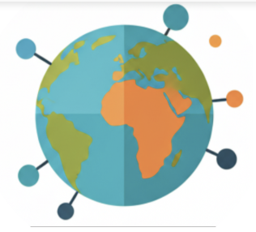{ width="300" }

* [NSF Award #2333789](https://www.nsf.gov/awardsearch/show-award?AWD_ID=2333789)
* PI: Eduard Dragut, Temple University
* Co-PI: Longin Jan Latecki
* [Website](https://climatepub4kg.github.io/)
* [Datasheet](../assets/datasheets/Climate-Models-Datasheet.pdf)
* [Project Overview Video](https://youtu.be/8Y4nu9Bql68)
* [Technical Video](https://youtu.be/1kQ5XqJV0X8)

### SOCKG: Soil Organic Carbon Knowledge Graph

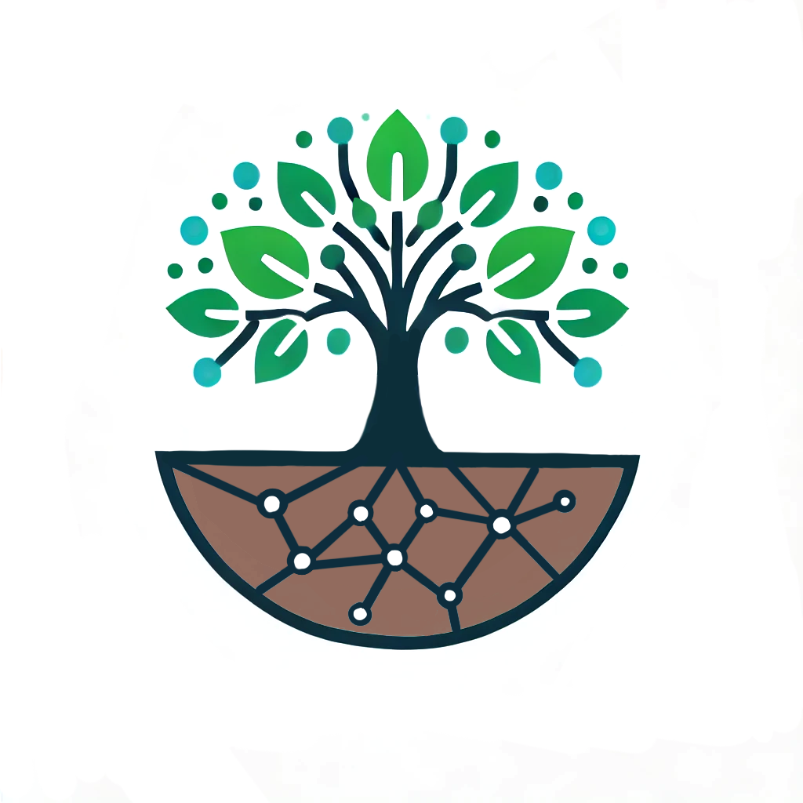{ width="300" }

* [NSF Award #2333834](https://www.nsf.gov/awardsearch/show-award?AWD_ID=2333834)
* PI: Chengkai Li, The University of Texas at Arlington
* Co-PI: Jianzhong Su
* [Website](https://idir.uta.edu/sockg/)
* [Datasheet](../assets/datasheets/SOCKG-Datasheet.pdf)
* [Project Overview Video](https://youtu.be/3QKuo-wXO6Q)
* [Technical Video](https://youtu.be/kH4BCtEFnW0)

## Justice

{ width="300" }

These projects are part of the Justice Group.

### RURAL-KG: A Cross-Domain Knowledge Graph to Integrate Health and Justice for Rural Resilience

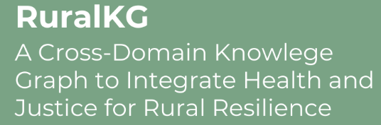{ width="300" }

* [NSF Award #2333836](https://www.nsf.gov/awardsearch/show-award?AWD_ID=2333836)
* PI: Jiaqi Gong, University of Alabama
* Co-PIs: James Geyer, Xiaoyan Hong, Matthew Hudnall, Hee Yun Lee
* [Website](https://sail-ua.github.io/okn-page/)
* [Datasheet](../assets/datasheets/RURAL-KG-UA-JGong.pdf)
* [Project Overview Video](https://youtu.be/Dx9a6rn_rcA)
* [Technical Video](https://youtu.be/SmZoYs-jFp0)

### IJP: An Integrated Justice Platform to Connect Criminal Justice Data Across Data Silos

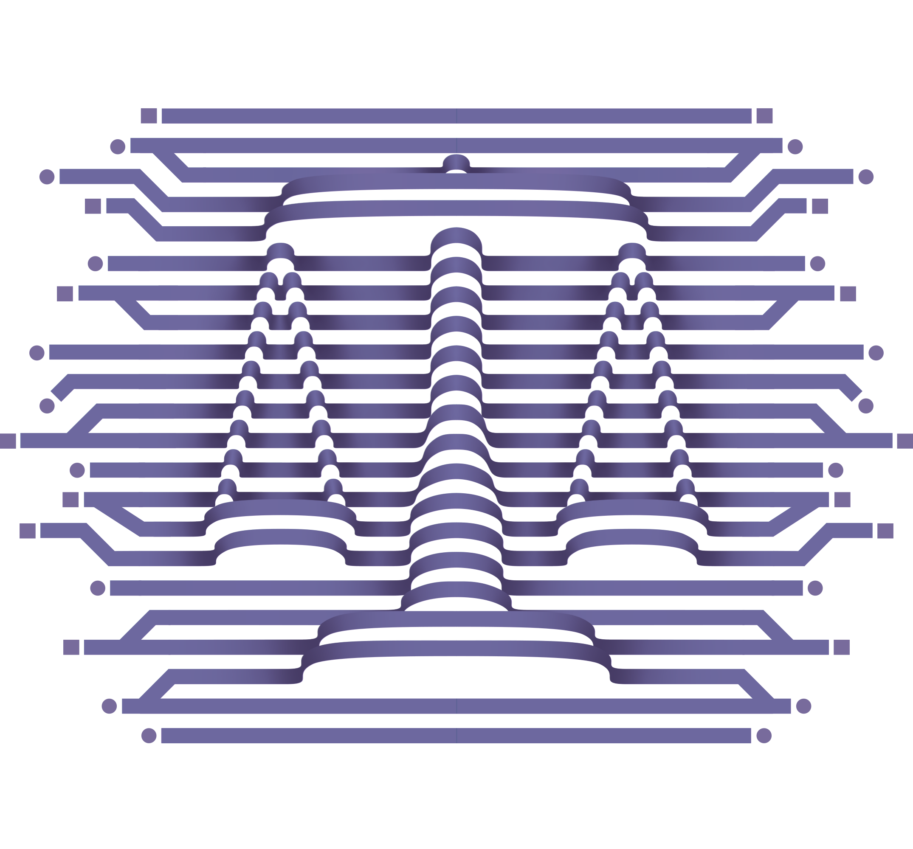{ width="300" }

* [NSF Award #2333803](https://www.nsf.gov/awardsearch/show-award?AWD_ID=2333803)
* PI: Adam Pah, Georgia State University; Charlotte Alexander
* [Website](https://scales-okn.org/integrated-justice-project/)
* [Datasheet](../assets/datasheets/IJP-Datasheet.pdf)
* [Project Overview Video](https://www.youtube.com/watch?v=29a9I_qc_RU)
* [Technical Video](https://www.youtube.com/watch?v=za9YXrFvX8w&pp=0gcJCfYJAYcqIYzv)

### NIKG: A Knowledge Graph Warehouse for Neighborhood Information

{ width="300" }

!!! info

    This use case was administratively terminated in 2025 before being allowed to resume later.

* [NSF Award #2333790](https://www.nsf.gov/awardsearch/show-award/?AWD_ID=2333790)
* PI: Jing Gao, Purdue University
* Co-PIs: Fenglong Ma, Jingbo Shang, Daniel Semenza
* [Website](https://sites.google.com/view/proto-okn-nikg/home)
* [Datasheet](../assets/datasheets/Knowledge-Graph-Warehouse-Datasheet.pdf)
* [Project Overview Video](https://youtu.be/cv1dqEDYVjY)
* [Technical Video](https://youtu.be/Mv6_I_Tla6A)

### DREAM-KG: Dynamic, Responsive, Adaptive, and Multifaceted Knowledge Graphs to Address Homelessness With Explainable AI

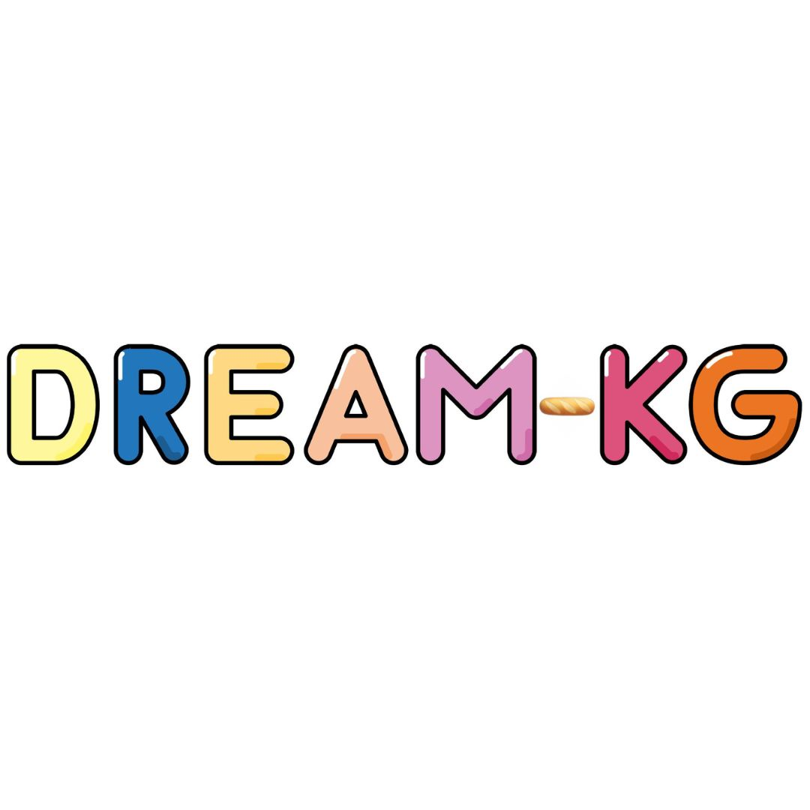{ width="300" }

* [NSF Award #2333703](https://www.nsf.gov/awardsearch/show-award?AWD_ID=2333703)
* PI: Yuzhou Chen, Temple University
* Co-PIs: Ying Ding, Chiu Tan, Huanmei Wu
* [Website](https://dreamkg.com/)
* [Datasheet](../assets/datasheets/DreamKG-Datasheet.pdf)
* [Project Overview Video](https://youtu.be/S-pOfgtU4ik)

## Technology & Manufacturing

{ width="300" }

These projects are part of the Technology & Manufacturing Group.

### CollabNext: A Person-Focused Metafabric for Open Knowledge Networks 

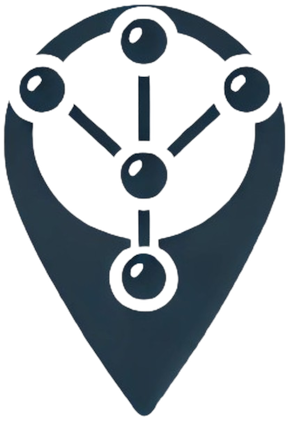{ width="300" }

!!! info

    This was one of the original use cases before its 2025 administrative termination.

* [NSF Award #2333737](https://www.nsf.gov/awardsearch/showAward?AWD_ID=2333737&HistoricalAwards=false)
* PI: Lew Lefton, Georgia Institute of Technology
* Co-PIs: Didier Contis, Kexin Rong
* [Website](https://collabnext.io/)
* [Datasheet](../assets/datasheets/CollabNext%20Datasheet.pdf)

### SecureChain: Knowledge Graph Construction for Resilient, Trustworthy, and Secure Software Supply Chains

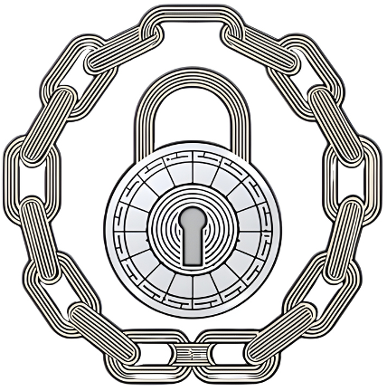{ width="300" }

* [NSF Award #2333736](https://www.nsf.gov/awardsearch/show-award?AWD_ID=2333736)
* PI: Tianyi Zhang, Purdue University
* Co-PIs: Muhao Chen, Xiang Ren, Xiangyu Zhang
* [Website](https://purdue-hcss.github.io/nsf-software-supply-chain_security/)
* [Datasheet](../assets/datasheets/SecureChain-Datasheet-v2.pdf)
* [Project Overview Video](https://youtu.be/PVErfUXS0dI)
* [Technical Video](https://youtu.be/ymuq3U5ht0w)

### SUDOKN: Supply and Demand Open Knowledge Network

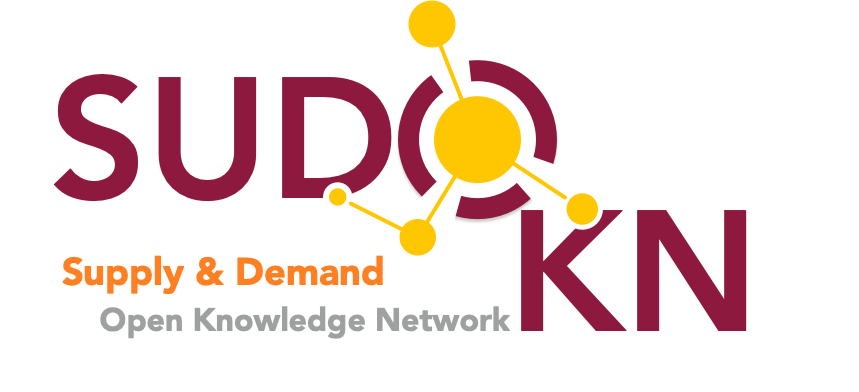{ width="300" }

* [NSF Award #2333801](https://www.nsf.gov/awardsearch/show-award?AWD_ID=2333801)
* PI: Farhad Ameri, Arizona State University
* Co-PIs: Srividya Bansal, Hyunwoong Ko, Binil Starly
* [Website](https://projects.engineering.asu.edu/sudokn/)
* [Datasheet](../assets/datasheets/SUDOKN-Datasheet.pdf)
* [Project Overview Video](https://youtu.be/SAEAx9ec42E)
* [Technical Video](https://youtu.be/TKOCmPfxerE)
